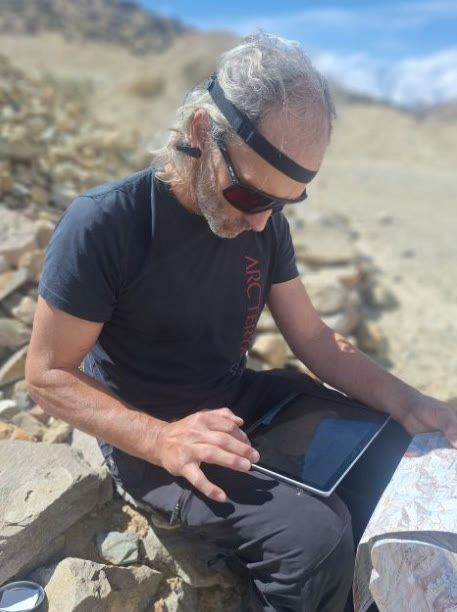
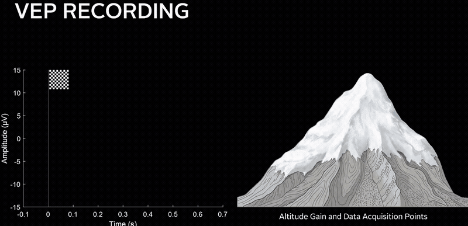
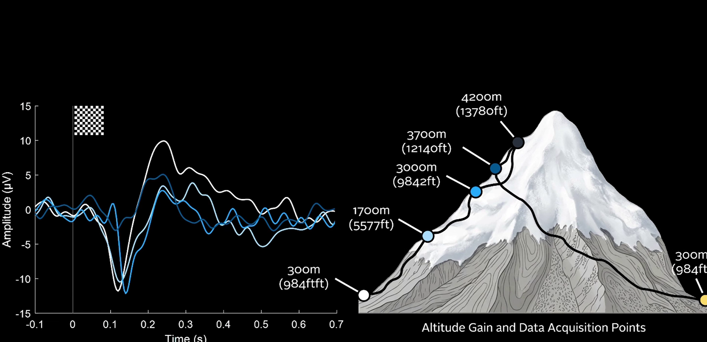
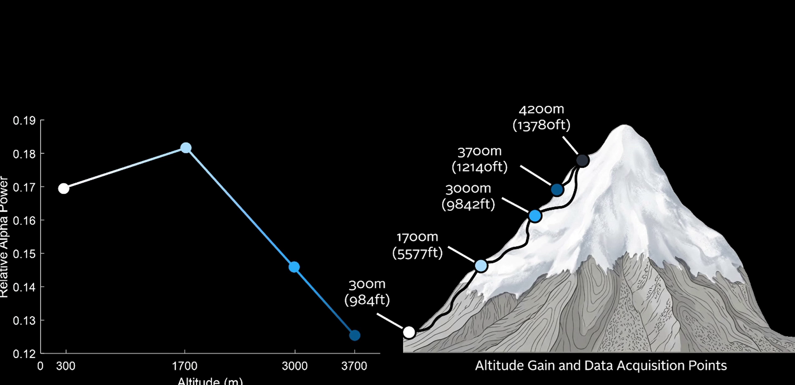
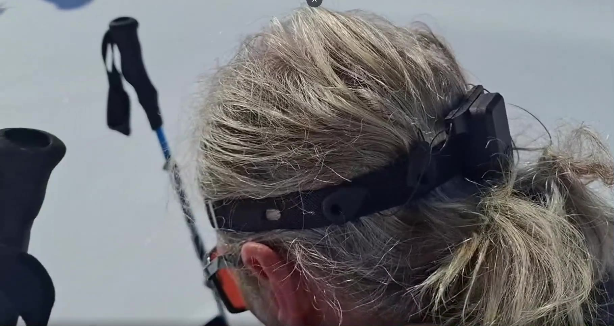

# g.tec Altitude Assessment

-lightgrey)

**Outdoor, EEG-based assessment of evoked-potential biomarkers (AEP, VEP) at
different elevations**, using a g.tec **BCI Core-4** or **BCI Core-8** amplifier.

Altitude Assessment is a touch-friendly, full-screen Windows application for the
field. Pick a location on a map, read off its elevation, then record auditory
(AEP) and visual (VEP) evoked potentials, or a resting-state EEG — each recording
automatically tagged with the subject, location, and altitude at which it was made.

> **This software is free for private use.** See [License](#license) below.

---

## Why measure evoked potentials at altitude?

VEPs and AEPs are very stable: repeated measurements in the same person usually
give the same response. Change one parameter, the altitude, and they change in a
measurable way. At the height of Mont Blanc (4,808 m) the body gets only about
half the oxygen it gets at sea level. Following the N100, P300 and VEP amplitude
and latency from day to day shows how the brain reacts to hypoxia and how fast it
acclimatizes.

Typical uses:

- **Expedition and trekking research**: track acclimatization over an ascent
  ("climb high, sleep low") with a dry-electrode headband and a laptop, no lab needed.
- **Field neuroscience teaching**: a complete VEP / AEP / resting-state experiment
  that students can run outdoors.
- **Hypoxia and performance studies**: compare evoked potentials and resting-state
  alpha with questionnaires, SpO₂ or cognitive tests at each elevation.

The app is for research and education only. It does not diagnose altitude sickness.

## Field results recorded with this app

These are single-subject field observations shared by Christoph Guger, not a
published study.

**Upper Mustang, Nepal (May 2026), up to 4,183 m.** Altitude Assessment on a Microsoft
Surface with the Unicorn BCI Core-4 Headband. Everything was charged once in Kathmandu and never
recharged on the trek, with no gel and no skin preparation.

| Elevation | P300 | N100 | Note |
|---|---|---|---|
| 3,100 m | ≈ 11 µV | ≈ −11 µV | just after arrival |
| 3,625 m | ≈ 2.5 µV | ≈ −3 µV | clear drop |
| 4,020 m | ≈ 5 µV | ≈ −5 µV | after one night: acclimatization |
| 3,960 m | ≈ 3 µV | ≈ −3.5 µV | after a day near 4,230 m |
| 4,183 m (Paa Pass) | ≈ 4 µV | ≈ −6 µV | |
| 352 m (Schiedlberg, back home) | ≈ 12 µV | ≈ −10 µV | earlier latencies than ever measured before |

**Mount Kazbek expedition (5,054 m), five elevations up to 4,200 m.** VEP amplitude
went from ≈ 10 µV at 300 m to ≈ 4 µV at 1,700 m and ≈ 3.5 µV (longest latency)
at 3,000 m, then rose again to ≈ 5.5 µV at 3,700 m after a climb to 4,200 m.
Relative resting alpha fell from 0.17 (300 m) to 0.125 (3,700 m). After the
expedition the P300 reached ≈ 12 µV. Recordings ran at down to −20 °C.

Posts with videos and plots:

- [Kazbek results: VEP and alpha at five altitudes](https://www.linkedin.com/feed/update/urn%3Ali%3AugcPost%3A7441871068090281984) (Mar 2026)
- [Heading to Mustang](https://www.linkedin.com/feed/update/urn%3Ali%3AugcPost%3A7456905381655576576) (May 2026)
- [Can high altitude temporarily enhance brain function?](https://www.linkedin.com/feed/update/urn%3Ali%3AugcPost%3A7474847085285195776) (Jun 2026)
- [The whole lab: headband, Surface, g.Pype](https://www.linkedin.com/feed/update/urn%3Ali%3Ashare%3A7474848396533551104) (Jun 2026)
- [What VEP, AEP and resting EEG show above 3,500 m](https://www.linkedin.com/feed/update/urn%3Ali%3AugcPost%3A7474849217963016192) (Jun 2026)
- [EEG changes along the trek, with VEP plot video](https://www.linkedin.com/feed/update/urn%3Ali%3AugcPost%3A7479774692598505472) (Jul 2026)

*Kazbek 2026: VEP (top) and relative alpha power (bottom) at each recording point, from 300 m up to 4,200 m and back to 3,700 m.*

| VEP by altitude | Resting alpha by altitude | Recording at 3,020 m |
|---|---|---|
|  |  |  |

---

## Download & install

Everything you need is in the **[latest release](../../releases/latest)**.
Two installers are provided; **run both — the order does not matter** — and the
app is ready to use.

| Installer | What it does |
|-----------|--------------|
| `ParadigmPresenterInstaller_x64.msi` | Installs the g.tec **Paradigm Presenter**, the stimulus-presentation engine used to run the VEP / AEP / resting-state paradigms. |
| `AltitudeAssessment-Setup-1.0.0.exe` | Installs the **Altitude Assessment** application itself. |

### Steps

1. Open the **[latest release](../../releases/latest)** and download both files.
2. Run `ParadigmPresenterInstaller_x64.msi` and `AltitudeAssessment-Setup-1.0.0.exe`
   (either order).
3. Launch **g.tec Altitude Assessment** from the Start menu or desktop shortcut.

The application installs **per-user** (to `%LocalAppData%\Programs\AltitudeAssessment`)
and requires **no administrator rights**.

---

## System requirements

- **Windows 10 or 11, 64-bit**
- **g.tec BCI Core-4** or **BCI Core-8** amplifier (connects over **Bluetooth Low
  Energy**) — required to acquire and record signals
- A **Bluetooth LE** adapter
- **Audio output** (for the AEP paradigm) and a suitable **display** (for the VEP
  paradigm)
- An **internet connection** — required only by the *Map* elevation picker; every
  other feature works fully offline

---

## Features

- **Scope** — live signal monitoring with a 1–30 Hz band-pass and a 48–52 Hz notch
  filter, for checking electrode contact and signal quality. *(Monitoring only — not
  recorded.)*
- **VEP Checkerboard** — visual evoked potential paradigm (checkerboard reversal).
- **AEP Oddball** — auditory evoked potential paradigm (target / non-target tones).
- **Resting state** — timed eyes-open/-closed resting recording.
- **Map** — an interactive OpenTopoMap picker: search or click a location, read its
  elevation, and drop named "cursors" so each recording is tagged with the place and
  altitude. Saved locations can be exported to CSV.
- **Settings** — manage the subject list, choose 4- or 8-channel acquisition (with an
  optional amplifier serial number), and pick full-screen or maximized window mode.

Stimuli are presented through g.tec Paradigm Presenter, which sends stimulus-onset
triggers to the application over UDP; those triggers are merged into the recording so
each sample is aligned with the stimulus that produced it.

---

## Using the app

1. **Select a subject** in the left-hand panel (add or remove subjects under
   **Settings**).
2. *(Optional)* Open **Map**, choose your location, and set a named cursor — this
   stamps the location name and elevation onto the recordings that follow.
3. Open **Scope** to verify signal quality.
4. Run **VEP Checkerboard**, **AEP Oddball**, or **Resting state**. Press the large
   **Start** button to begin and **Stop** to end; press **Esc** to close the app.

### Where recordings and settings go

All output is written next to the executable, under
`%LocalAppData%\Programs\AltitudeAssessment\`, so it persists across runs:

| Path | Contents |
|------|----------|
| `data\vep\`, `data\aep\`, `data\resting\` | Recorded EEG as CSV, e.g. `vep_<subject>_<location>_<elevation>.csv` |
| `subjects.json` | Subject list |
| `amp_config.json` | Amplifier & window settings |
| `map_markers.json`, `map_location.json` | Saved map cursors and last map view |

---

## Troubleshooting

- **The map shows "No internet connection."** The map picker needs internet to load
  tiles and look up elevation; the paradigms and scope do not. Reconnect and reopen the
  Map page.
- **The amplifier isn't found.** Make sure the BCI Core is powered on and in range, and
  that Bluetooth is enabled. If you run more than one amplifier nearby, set the specific
  serial number under **Settings → Amplifier**. Also confirm the channel count (4 or 8)
  matches your device.
- **No stimuli appear when starting a paradigm.** Confirm the Paradigm Presenter
  installer (`ParadigmPresenterInstaller_x64.msi`) was run.

---

## License

This software is **free for private, personal, non-commercial use**. All rights are
reserved by g.tec medical engineering GmbH. See the full terms in [LICENSE](LICENSE).

> **Not a medical device.** g.tec Altitude Assessment is intended for research and
> educational use only. It is **not** intended for the diagnosis, treatment, or
> prevention of any disease or medical condition.

Bundled third-party components (e.g. Qt / PySide6 and other open-source libraries)
remain under their own respective licenses.

---

## Learn more

- [Unicorn BCI Core-4 / Core-8](https://www.gtec.at/) — the amplifiers this app supports
- [g.Pype](https://gpype.gtec.at/) — the Python framework the app is built with
- [Open Unicorn EEG datasets](https://github.com/unicorn-bi/Unicorn-BCI-Core-8-EEG-Datasets) — VEP, auditory oddball and resting-state reference recordings at sea level
- [Space, altitude and extreme environments](https://github.com/gtec-neurotechnology/g.tec-neurotechnology-knowledge/blob/main/domains/space-altitude-and-extreme-environments.md) — g.tec knowledge base

---

## Support

For questions about the g.tec BCI Core amplifiers or this application, visit
[www.gtec.at](https://www.gtec.at).

© 2026 g.tec medical engineering GmbH. "g.tec", "BCI Core", and "Paradigm Presenter"
are trademarks of g.tec medical engineering GmbH.
